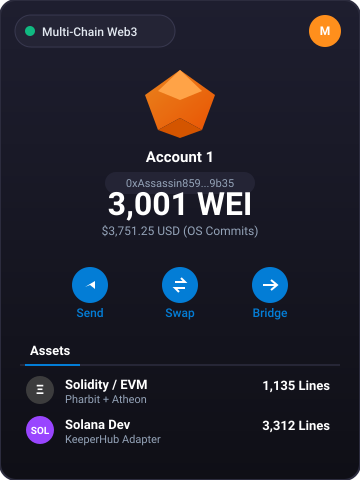
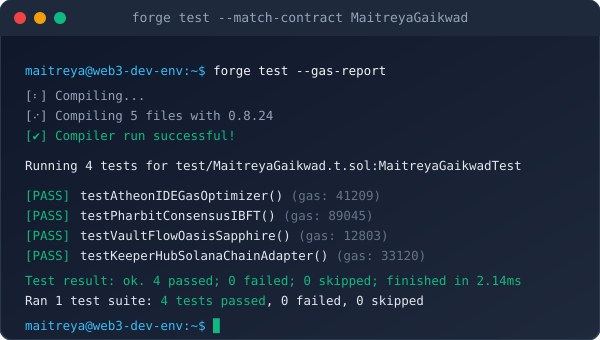

<div align="center">


<br/>


[](https://twitter.com/assassin_859)
[](https://www.linkedin.com/in/maitreya-gaikwad-9b358b2a4)
[](https://github.com/Assassin859)
[](mailto:maitreyagaikwad859@gmail.com)

</div>

---

## About

Security researcher and smart-contract engineer focused on execution safety, Foundry verification, and developer tooling — currently with **Remix Labs** on TheDAO Security Fund initiative for AI-guided checklist audits in Remix.

- **Remix Labs · TheDAO** — Phase 3 Foundry prove-step for Cyfrin checklist findings (fail-before-fix / pass-after-fix)
- Sole engineer on a private Ethereum pharma supply-chain platform (**Hyperledger Besu**, IBFT 2.0, 4-node AWS, 5 production Solidity contracts)
- **KeeperHub Community Partner** — 19 merged PRs (~18.5k LOC) across Solana adapter, MCP/agent DX, and execution safety
- Merged contributor to **OpenZeppelin Contracts**
- **ETHOnline 2026** (ETHGlobal) · **DoraHacks** Best UI/UX bounty winner

**Focus:** execution safety, money-moving correctness, and verifiable audit tooling.

---

## Web3 Developer Dashboard

<div align="center">
  <table>
    <tr>
      <td valign="top">
        
      </td>
      <td valign="top">
        
      </td>
    </tr>
  </table>
</div>

---

```solidity
// SPDX-License-Identifier: MIT
pragma solidity ^0.8.24;

/// @title Profile — stylized skill registry (not deployed)
/// @notice Maitreya Gaikwad · Security Researcher · Remix Labs · Mumbai, India
contract Profile {
    string public constant NAME = "Maitreya Gaikwad";
    string public constant ROLE = "Security Researcher | Remix Labs · TheDAO | Foundry & EVM tooling";
    string public constant LOCATION = "Mumbai, India | Remote";

    string[] public languages;
    string[] public blockchain;
    string[] public backend;
    string[] public devops;

    constructor() {
        languages = ["Solidity", "TypeScript", "JavaScript", "Python", "SQL"];
        blockchain = [
            "Ethereum",
            "Solana",
            "Hyperledger Besu (IBFT 2.0)",
            "Hardhat",
            "Foundry",
            "OpenZeppelin",
            "Ethers.js",
            "Wagmi",
            "Web3.js",
            "IPFS"
        ];
        backend = ["Node.js", "Express.js", "Supabase", "PostgreSQL", "MySQL", "REST APIs"];
        devops = ["AWS (EC2)", "Docker", "GitHub Actions / CI-CD", "Vercel", "Netlify"];
    }
}
```

---

## Block Explorer (Projects & Deployments)

| Txn | Method | Block | Project | Status |
| :--- | :--- | :--- | :--- | :---: |
| [`0xa82d…7f6b`](https://github.com/Assassin859/cryptp) | `deployAethonIDE` | 2025–Present | **[Aethon IDE](https://cryptp-production.up.railway.app)** — browser-native Solidity IDE with AST scanner, deploy gate, gas heatmap, BYOK AI · ETHOnline 2026 | Success |
| [`0xrp…usdg`](https://github.com/Assassin859/ReserveProof) | `proveReserves` | 2026 | **[ReserveProof](https://reserveproof-teal.vercel.app)** — open-source proof of reserves + ExitRight (USDG / Robinhood stock tokens) · Foundry fuzz | Success |
| [`0xegd…bsc`](https://github.com/Assassin859/executable-gap-desk) | `gateExecutableGap` | 2026 | **[Executable Gap Desk](https://executable-gap-desk.vercel.app)** — displayed vs executable gaps for tokenized stocks on BSC · GO/CAUTION/BLOCK | Success |
| [`0x4d2e…9a3c`](https://pharbit.com) | `createPharbitChain` | 2024–2026 | **[Pharbit](https://pharbit.com)** — Besu private chain, 5 Solidity contracts, 4-node AWS validators · [codebase](https://github.com/Maitreyapharbit/Blockchain) | Success |
| [`0x92f8…2b1a`](https://github.com/Assassin859/vaultflow) | `launchVaultFlow` | 2025 | **[VaultFlow](https://vaultflow-production-8062.up.railway.app)** — DeFi lending on Oasis Sapphire Testnet | Success |
| [`0x7c3a…6e8f`](https://github.com/Assassin859/chainquest-home-task) | `deployChainQuest` | 2024 | **[ChainQuest](https://github.com/Assassin859/chainquest-home-task)** — on-chain bounty escrow (ETH/ERC-20, fee routing) | Success |
| [`0x5d8c…3b9e`](https://github.com/Assassin859/AI-CFO) | `initAICFO` | 2024 | **[AI-CFO](https://github.com/Assassin859/AI-CFO)** — AI startup treasury tooling | Success |
| [`0xkhub…19pr`](https://github.com/KeeperHub/keeperhub) | `mergeKeeperHubPRs` | 2026 | **[KeeperHub](https://github.com/KeeperHub/keeperhub)** — Community Partner · 19 merged PRs (Solana + MCP + execution safety) | Merged |
| [`0x6604…oz`](https://github.com/OpenZeppelin/openzeppelin-contracts/pull/6604) | `addMerkleTreeTests` | 2026 | **[OpenZeppelin #6604](https://github.com/OpenZeppelin/openzeppelin-contracts/pull/6604)** — MerkleTree non-commutative hashing tests | Merged |

---

## Open Source

### [KeeperHub](https://github.com/KeeperHub/keeperhub) — Community Partner · Jul–Sep 2026

**19 merged PRs** (~18.5k lines added) across three areas:

| Area | Highlights |
| :--- | :--- |
| **Solana foundation** | ChainAdapter read/write paths — balances, explorer URLs, failover, spend caps, SPL coverage, fees, blockhash retry, Turnkey signing |
| **Agent / MCP DX** | Dev-login recovery, MCP aliases & manifest sync, structured errors, auth → `apiError` envelope, hackathon quickstart docs |
| **Execution safety** | Required-param rejection, idempotency keys, refuse re-dispatch of terminal executions, stop For-Each on iteration failure |

Also filed [#2435](https://github.com/KeeperHub/keeperhub/issues/2435) (stablecoin-to-gas top-up) and implementing the follow-up PR.

### [OpenZeppelin Contracts](https://github.com/OpenZeppelin/openzeppelin-contracts)

- **[#6604](https://github.com/OpenZeppelin/openzeppelin-contracts/pull/6604)** — non-commutative hashing test coverage for `MerkleTree`; reviewed and merged by core maintainers

---

## Experience

| Role | Org | Period |
| :--- | :--- | :--- |
| **Security Researcher** | Remix Labs · TheDAO Security Fund initiative | 2026 – Present |
| **Blockchain Engineer (Contract)** | Pharbit Technologies · Remote / Germany | Aug 2024 – Jul 2026 |
| **Freelance Blockchain Developer** | Self-employed · Mumbai | May 2024 – Aug 2024 |

**Pharbit highlights:** sole engineer for full blockchain stack — Besu IBFT 2.0 network, USDT-backed custody contracts with OpenZeppelin access control + reentrancy guards, IPFS document verification, React + Supabase + Ethers.js admin dashboard.

---

## Hackathons

- **ETHOnline 2026 (ETHGlobal)** — submitted Aethon IDE (continuity track); Chainlink CRE, The Graph, Uniswap v4 CounterHook integrations
- **KeeperHub × DoraHacks 2026** — Winner, Best UI/UX Bounty

---

## Education & Certifications

- **B.E. Computer Science — Blockchain Specialization** · University of Mumbai · Expected 2028
- **Build on BNB Chain / BNB Chain Fundamentals** · Rise In · Jul 2025
- **Ethereum Bootcamp** · Alchemy University · 2024
- **AI for Techies** · Microsoft · Feb 2025

---

## Tech Stack

```text
Blockchain   Solidity · Hyperledger Besu · Ethereum · Solana · Hardhat · Foundry
             OpenZeppelin · IPFS · Ethers.js · Web3.js · Wagmi
Backend      Node.js · Express · Supabase · PostgreSQL · MySQL · REST
Frontend     React · Next.js · TypeScript · Tailwind · Monaco / Vite
Infra        AWS EC2 · Docker · GitHub Actions · Vercel · Netlify
```

---

## Stats

<div align="center">

[](https://git.io/streak-stats)

<br/>


</div>

### Contribution snake

<div align="center">

<picture>
  <source media="(prefers-color-scheme: dark)" srcset="https://raw.githubusercontent.com/Assassin859/Assassin859/output/github-contribution-grid-snake-dark.svg">
  <source media="(prefers-color-scheme: light)" srcset="https://raw.githubusercontent.com/Assassin859/Assassin859/output/github-contribution-grid-snake.svg">
  
</picture>

</div>

---

<div align="center">

[](https://discord.com)

**Security research · Foundry verification · EVM tooling** · Remix Labs · TheDAO

*LLM explains; Foundry proves.*

</div>
